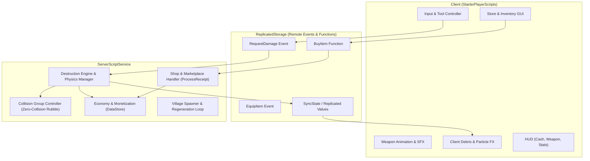
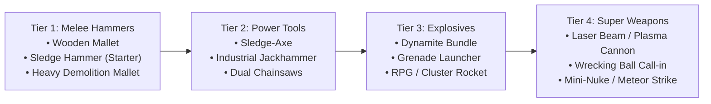
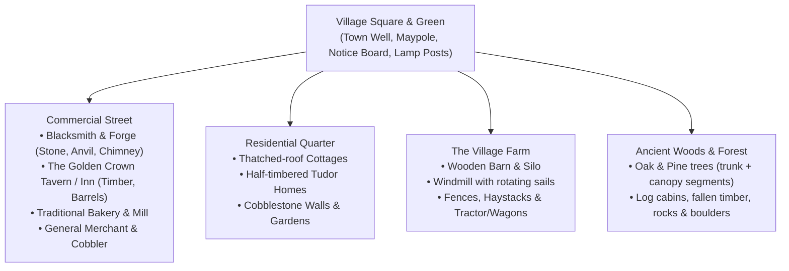

# Destruction Village: Master Architecture & Technical Plan

## 1. Project Overview & Setup Status

- **Engine & Runtime**: Roblox Engine (Luau)
- **Toolchain**: Rojo `7.7.1` (Upgraded & Verified), Git (`main` branch initialized)
- **Core Loop**: Smash village assets &rarr; Earn Dollars ($) &rarr; Buy heavier weapons, skins & auras (via $ or Robux) &rarr; Unlock bigger destruction tiers &rarr; Repeat.

---

## 2. Core Game Architecture

---

## 3. Destruction Engine & "Zero-Collision" Physics

### 3.1 What "Collisions Should Not Be Possible" Means in Roblox
Unconstrained physics on hundreds of unanchored parts can quickly destroy server tick rate and cause player flinging glitches. We solve this with a dedicated collision matrix:

| Collision Group | Collides With Players? | Collides With Other Debris? | Collides With Map / Floor? | Rationale |
| :--- | :--- | :--- | :--- | :--- |
| **Players** | Default | **NO** | Yes | Players will never get trapped, shoved, or flung by falling rubble. |
| **Debris** | **NO** | **NO** (Optional visual bounce only) | Yes (Terrain/Ground) | Eliminates physics solver explosions and micro-stutters when a building collapses. |
| **Destructibles** | Yes (until broken) | N/A | Yes | Solid buildings before destruction; once damaged/broken, instantly assigned to **Debris**. |

### 3.2 Part Splitting & Destruction Mechanics
1. **Structural Health Hierarchy**:
   - Every building, tree, cart, and prop has tagged components (`CollectionService: "Destructible"`).
   - Components have Health (`HP`), Material Type (Wood, Stone, Glass, Metal), and Dollar Value ($).
2. **Breakage Trigger**:
   - When HP drops to 0, parts unanchor, switch to `CollisionGroup = "Debris"`, receive an initial physics impulse directed away from the weapon impact point, and fade out via TweenService before cleanup (`Debris:AddItem(part, 2.5)`).
3. **Regeneration / Map Persistence**:
   - A central **MapLifecycle** tracks destroyed structures.
   - Configurable respawn timer (e.g., 30–60s) recreates the structure seamlessly so the map is never permanently empty.

---

## 4. Weapons & Progression System

### 4.1 Starting Weapon: Sledge Hammer
- **Melee Arc**: Spatial query (`workspace:GetPartBoundsInRadius` / raycast cone) triggered on swing.
- **Base Stats**: 50 Damage, 4 Stud Radius, 0.8s Swing Cooldown.

### 4.2 Scaled Weapon Tiers

---

## 5. Economy, Store & Monetization

### 5.1 Dual-Currency Purchasing
Players can purchase any catalog item using either:
1. **In-game Dollars ($)** earned by smashing buildings and props.
2. **Robux** via Developer Products (instant unlock / currency packs) or Gamepasses.

### 5.2 Store Categories
1. **Weapons Shop**: Buy weapons with higher damage, larger AOE, and faster attack rates.
2. **Weapon Skins**: Visual skins applied to tools (e.g. *Golden Sledge*, *Magma*, *Cyberpunk*, *Galaxy*).
3. **Character Auras**: Visual effects emitted from the character (e.g. *Dollar Rain Aura*, *Thunder Spark Aura*, *Fiery Inferno*, *Void Rift*).
4. **Boosts / Passes**: 2x Cash, VIP Hammer, Auto-Smash, Extra Speed.

---

## 6. Map Design: Old English Village

The map will feature authentic traditional Old English architecture, organized into distinct destructible zones:

---

## 7. Implementation Roadmap

### Phase 1: Engine Foundation & Physics Setup
- [x] Rojo 7.7.1 upgrade and Git repository initialization
- [x] Base project manifest and directory structure
- [ ] PhysicsService collision groups setup (Debris, Players, Destructibles)
- [ ] DestructionEngine core module (health, impulse, unanchor, debris disposal, respawn loop)

### Phase 2: Combat & Sledgehammer
- [ ] Sledgehammer model, animations, sound effects, and spatial hit-detection
- [ ] Server verification of hits & damage calculation
- [ ] Dollar drop / award system with floating damage & cash popup indicators

### Phase 3: Old English Village World Building
- [ ] Procedural/modular builder or models for cottages, shops, farm, and forest
- [ ] Destruction tagging (`Destructible` tag, HP scaling based on material: wood < stone < iron)
- [ ] Auto-regeneration manager for village assets

### Phase 4: Economy, Shop & Monetization
- [ ] DataStore persistence for Dollars, Owned Weapons, Skins, and Auras
- [ ] Shop GUI (Weapons, Skins, Auras) with dual currency support ($ and Robux)
- [ ] `MarketplaceService.ProcessReceipt` handler for secure Robux purchases

### Phase 5: Cosmetics (Auras & Skins) & Polish
- [ ] Particle aura attachment system for characters
- [ ] Weapon skinning pipeline
- [ ] Camera shake, destruction sound effects, and UI animations
